<picture>
  <source media="(prefers-color-scheme: dark)" srcset="./assets/terminal-dark.svg"/>
  
</picture>

  
  
  
  

### Hi, I'm Sha Newaz 👋

A software engineer from Bangladesh who likes taking AI ideas all the way to production: training the model, wrapping it in an API, and shipping it on Docker and Kubernetes. I graduated in CSE from **CUET** in 2026.

- 🛠️ Building LLM services, RAG pipelines and the infrastructure that runs them
- 🔬 Researching Bangla NLP: **7 published papers**, including SemEval and ACL shared tasks
- 🌱 Currently: **Associate (AI)** at BdOSN and **Research Fellow** at ARIBD
- 🎯 Open to **MS / RA positions in NLP** and **AI/ML engineering roles**

### 🧰 Tech stack

### 🚀 Featured projects

| Project | What it does | Built with |
|---|---|---|
| **[HealthPort](https://github.com/SM-Shaan/HealthPort)** | AI symptom checker over 493K+ disease-symptom mappings, with hospital search and booking | `FastAPI` `React` `ChromaDB` `Ollama` |
| **[AI-Powered 360 Learning](https://github.com/SM-Shaan/AI-Powered_360_Learning)** | RAG course assistant with A/B-tested retrieval strategies | `FastAPI` `LangChain` `ChromaDB` |
| **[Care For All](https://github.com/SM-Shaan/API_Hackathon_Innovatrix)** | Event-driven donation platform with real-time tracking over WebSockets | `Next.js` `PostgreSQL` `Redis` `Docker` |
| **[Async Task Processing](https://github.com/poridhioss/asynchronous_task_processing_system_using_Flask_Celery_RabbitMQ)** | Background task queue with a Redis result backend, fully containerized | `Flask` `Celery` `RabbitMQ` |

### 📄 Selected research

- **[Multilingual Polarization Detection with LLM Prompting and Transformer Fine-Tuning](https://aclanthology.org/2026.semeval-1.366/)**, SemEval 2026 · 4th in Bengali
- **[Adaptive Generation of Critical Questions for Argumentative Interventions](https://aclanthology.org/2025.argmining-1.32/)**, ArgMining @ ACL 2025 · 7th place
- **[Bengali Emotion Classification with Deep Learning and Transformers](https://dx.doi.org/10.55708/js0506004)**, JENRS 2026 (journal)

More on [Google Scholar](https://scholar.google.com/citations?user=ynP5G74AAAAJ&hl=en).

### 🤝 Open source

- **[Rira: AI Social Media Manager](https://github.com/AdidR10/Rira-AISocialMediaManager)**: backend API routes ([#2](https://github.com/AdidR10/Rira-AISocialMediaManager/pull/2)) and authentication ([#1](https://github.com/AdidR10/Rira-AISocialMediaManager/pull/1)), both merged
- Also contributed to [JobPortal](https://github.com/Rakib-Hasan25/team-innovatrix-hack), [Admission Assist App](https://github.com/sadman017/Admission_Assist-App) and [Dynamic Allocation Ray Tracing](https://github.com/faysaltaysir/Dynamic-_Allocation-Ray_Tracing)

### 📊 GitHub stats

<picture>
  <source media="(prefers-color-scheme: dark)" srcset="https://streak-stats.demolab.com?user=sm-shaan&hide_border=true&border_radius=10&background=0d1117&stroke=30363d&ring=0a84ff&fire=ff9f0a&currStreakNum=f0f6fc&sideNums=f0f6fc&currStreakLabel=0a84ff&sideLabels=8b949e&dates=8b949e"/>
  
</picture>

### 🏆 GitHub trophies

<a href="https://github.com/ryo-ma/github-profile-trophy">
  <picture>
    <source media="(prefers-color-scheme: dark)" srcset="https://github-trophies.vercel.app/?username=sm-shaan&theme=onedark&no-frame=true&no-bg=true&column=7&margin-w=8&margin-h=8&title=MultiLanguage,LongTimeUser,Commits,Repositories,PullRequest,Issues,Followers"/>
    
  </picture>
</a>

### 🧩 Contribution jigsaw

<picture>
  <source media="(prefers-color-scheme: dark)" srcset="./assets/contribution-puzzle-dark.svg"/>
  
</picture>

---

💬 Want to build something together? Reach me on <a href="https://linkedin.com/in/sha-newaz-mahmud">LinkedIn</a>.
